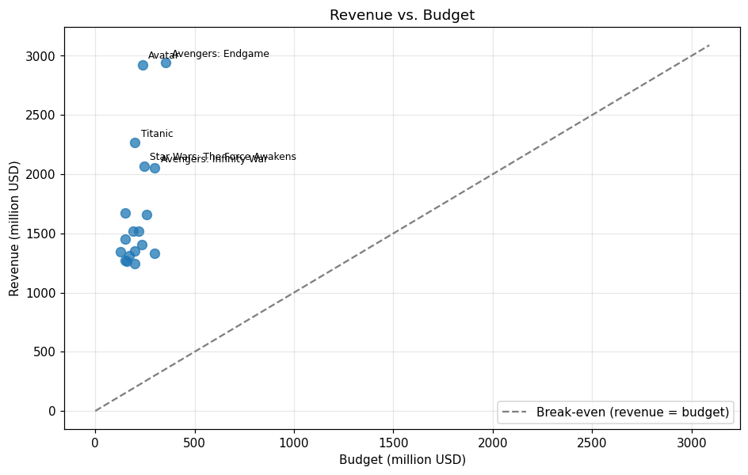
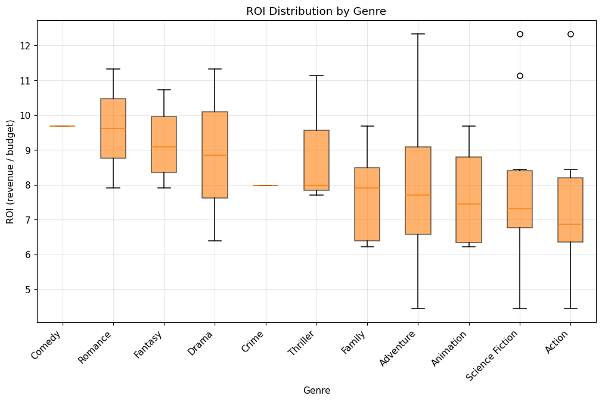
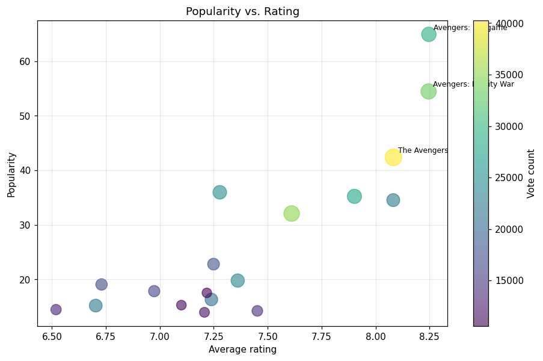
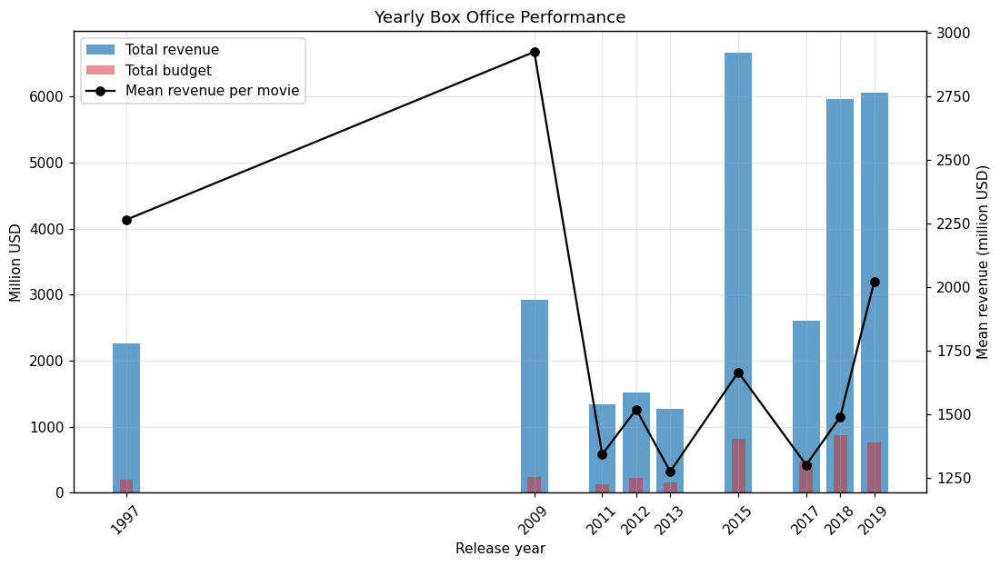
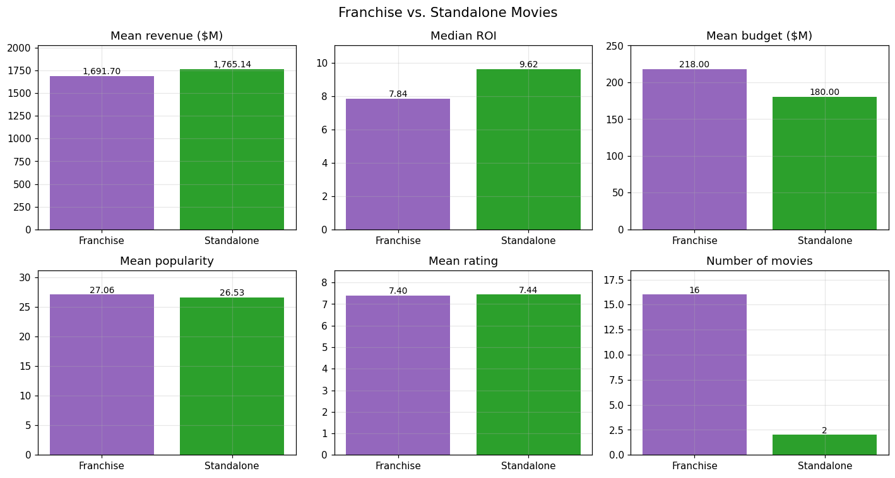

# TMDB Movie Data Analysis with PySpark: Final Report

## 1. Key Insights

- **Avengers: Endgame** is the highest-grossing film at **$2,942M**.
- **Avatar** made the largest profit (**$2,687M**).
- ROI ranges from **4.45x** (Star Wars: The Last Jedi) to **12.34x** (Avatar).
- 18 of 18 movies with known budget and revenue were profitable.
- Top franchise by revenue: **The Avengers Collection** (4 films, $7,919M).
- Top director by revenue: **James Cameron** (2 films, $5,188M).
- Correlation between popularity and rating: r = 0.84.

## 2. Methodology

**Extraction:** TMDB `/movie/{id}` with `append_to_response=credits`; retries on 429/5xx; invalid IDs skipped; raw JSON cached. 19 IDs requested, 18 returned.

**Cleaning:** dropped irrelevant columns; flattened nested JSON into pipe-separated strings; derived cast, director, cast_size and crew_size from credits; cast types; zero budget/revenue/runtime set to null; money in millions USD; ratings with 0 votes nulled; text placeholders nulled; removed duplicates, rows without id/title and rows with < 10 non-null values; kept Released movies only. Final dataset: 18 movies.

**Analysis:** profit and ROI added; a reusable ranking UDF (`rank_movies`) produces all rankings; grouped aggregations for franchises, standalone movies and directors; Matplotlib charts.

## 3. KPI Rankings

### Highest Revenue

| rank | title | revenue_musd | budget_musd |
| --- | --- | --- | --- |
| 1 | Avengers: Endgame | 2,942.19 | 356.00 |
| 2 | Avatar | 2,923.71 | 237.00 |
| 3 | Titanic | 2,264.16 | 200.00 |
| 4 | Star Wars: The Force Awakens | 2,068.22 | 245.00 |
| 5 | Avengers: Infinity War | 2,052.41 | 300.00 |

### Highest Budget

| rank | title | budget_musd | revenue_musd |
| --- | --- | --- | --- |
| 1 | Avengers: Endgame | 356.00 | 2,942.19 |
| 2 | Avengers: Infinity War | 300.00 | 2,052.41 |
| 2 | Star Wars: The Last Jedi | 300.00 | 1,334.41 |
| 4 | The Lion King | 260.00 | 1,662.02 |
| 5 | Star Wars: The Force Awakens | 245.00 | 2,068.22 |

### Highest Profit

| rank | title | profit_musd | budget_musd | revenue_musd |
| --- | --- | --- | --- | --- |
| 1 | Avatar | 2,686.71 | 237.00 | 2,923.71 |
| 2 | Avengers: Endgame | 2,586.19 | 356.00 | 2,942.19 |
| 3 | Titanic | 2,064.16 | 200.00 | 2,264.16 |
| 4 | Star Wars: The Force Awakens | 1,823.22 | 245.00 | 2,068.22 |
| 5 | Avengers: Infinity War | 1,752.41 | 300.00 | 2,052.41 |

### Lowest Profit

| rank | title | profit_musd | budget_musd | revenue_musd |
| --- | --- | --- | --- | --- |
| 1 | Star Wars: The Last Jedi | 1,034.41 | 300.00 | 1,334.41 |
| 2 | Incredibles 2 | 1,043.23 | 200.00 | 1,243.23 |
| 3 | Beauty and the Beast | 1,106.12 | 160.00 | 1,266.12 |
| 4 | Frozen | 1,124.22 | 150.00 | 1,274.22 |
| 5 | Jurassic World: Fallen Kingdom | 1,140.47 | 170.00 | 1,310.47 |

### Highest ROI (budget >= $10M)

| rank | title | roi | budget_musd | revenue_musd |
| --- | --- | --- | --- | --- |
| 1 | Avatar | 12.34 | 237.00 | 2,923.71 |
| 2 | Titanic | 11.32 | 200.00 | 2,264.16 |
| 3 | Jurassic World | 11.14 | 150.00 | 1,671.54 |
| 4 | Harry Potter and the Deathly Hallows: Part 2 | 10.73 | 125.00 | 1,341.51 |
| 5 | Frozen II | 9.69 | 150.00 | 1,453.68 |

### Lowest ROI (budget >= $10M)

| rank | title | roi | budget_musd | revenue_musd |
| --- | --- | --- | --- | --- |
| 1 | Star Wars: The Last Jedi | 4.45 | 300.00 | 1,334.41 |
| 2 | Avengers: Age of Ultron | 5.98 | 235.00 | 1,405.40 |
| 3 | Incredibles 2 | 6.22 | 200.00 | 1,243.23 |
| 4 | The Lion King | 6.39 | 260.00 | 1,662.02 |
| 5 | Black Panther | 6.75 | 200.00 | 1,349.93 |

### Most Voted

| rank | title | vote_count | vote_average |
| --- | --- | --- | --- |
| 1 | The Avengers | 40259 | 8.08 |
| 2 | Avatar | 34959 | 7.61 |
| 3 | Avengers: Infinity War | 33328 | 8.25 |
| 4 | Avengers: Endgame | 29209 | 8.25 |
| 5 | Titanic | 28011 | 7.90 |

### Highest Rated (>= 10 votes)

| rank | title | vote_average | vote_count |
| --- | --- | --- | --- |
| 1 | Avengers: Endgame | 8.25 | 29209 |
| 2 | Avengers: Infinity War | 8.25 | 33328 |
| 3 | The Avengers | 8.08 | 40259 |
| 4 | Harry Potter and the Deathly Hallows: Part 2 | 8.08 | 22690 |
| 5 | Titanic | 7.90 | 28011 |

### Lowest Rated (>= 10 votes)

| rank | title | vote_average | vote_count |
| --- | --- | --- | --- |
| 1 | Jurassic World: Fallen Kingdom | 6.52 | 13138 |
| 2 | Jurassic World | 6.70 | 22083 |
| 3 | Star Wars: The Last Jedi | 6.73 | 16841 |
| 4 | Beauty and the Beast | 6.97 | 16282 |
| 5 | The Lion King | 7.10 | 10999 |

### Most Popular

| rank | title | popularity | vote_average |
| --- | --- | --- | --- |
| 1 | Avengers: Endgame | 64.93 | 8.25 |
| 2 | Avengers: Infinity War | 54.46 | 8.25 |
| 3 | The Avengers | 42.38 | 8.08 |
| 4 | Avengers: Age of Ultron | 35.97 | 7.28 |
| 5 | Titanic | 35.22 | 7.90 |

## 4. Search Queries

### Search 1: Sci-Fi Action with Bruce Willis

_No rows returned._

### Search 2: Uma Thurman directed by Tarantino

_No rows returned._

The assigned dataset has no such films, so empty results are correct. On the validation set:

| title | genres | vote_average | vote_count |
| --- | --- | --- | --- |
| The Fifth Element | Science Fiction\|Action\|Adventure | 7.59 | 12320 |
| Looper | Action\|Thriller\|Science Fiction | 6.92 | 11322 |
| Armageddon | Action\|Science Fiction\|Adventure | 6.83 | 8941 |

| title | director | runtime | release_date |
| --- | --- | --- | --- |
| Kill Bill: Vol. 1 | Quentin Tarantino | 111.00 | 2003-10-10 |
| Kill Bill: Vol. 2 | Quentin Tarantino | 136.00 | 2004-04-16 |
| Pulp Fiction | Quentin Tarantino | 154.00 | 1994-09-10 |

## 5. Franchise vs. Standalone

| movie_type | movie_count | mean_revenue_musd | median_roi | mean_budget_musd | mean_popularity | mean_rating |
| --- | --- | --- | --- | --- | --- | --- |
| Franchise | 16 | 1,691.70 | 7.84 | 218.00 | 27.06 | 7.40 |
| Standalone | 2 | 1,765.14 | 9.62 | 180.00 | 26.53 | 7.44 |

## 6. Most Successful Franchises

| franchise | movie_count | total_budget_musd | mean_budget_musd | total_revenue_musd | mean_revenue_musd | mean_rating |
| --- | --- | --- | --- | --- | --- | --- |
| The Avengers Collection | 4 | 1,111.00 | 277.75 | 7,918.82 | 1,979.71 | 7.96 |
| Star Wars Collection | 2 | 545.00 | 272.50 | 3,402.63 | 1,701.32 | 6.98 |
| Jurassic Park Collection | 2 | 320.00 | 160.00 | 2,982.01 | 1,491.00 | 6.61 |
| Avatar Collection | 1 | 237.00 | 237.00 | 2,923.71 | 2,923.71 | 7.61 |
| Frozen Collection | 2 | 300.00 | 150.00 | 2,727.90 | 1,363.95 | 7.23 |
| The Lion King (Reboot) Collection | 1 | 260.00 | 260.00 | 1,662.02 | 1,662.02 | 7.10 |
| The Fast and the Furious Collection | 1 | 190.00 | 190.00 | 1,515.40 | 1,515.40 | 7.21 |
| Black Panther Collection | 1 | 200.00 | 200.00 | 1,349.93 | 1,349.93 | 7.36 |
| Harry Potter Collection | 1 | 125.00 | 125.00 | 1,341.51 | 1,341.51 | 8.08 |
| The Incredibles Collection | 1 | 200.00 | 200.00 | 1,243.23 | 1,243.23 | 7.45 |

## 7. Most Successful Directors

| director | movies_directed | total_revenue_musd | mean_rating |
| --- | --- | --- | --- |
| James Cameron | 2 | 5,187.87 | 7.76 |
| Anthony Russo | 2 | 4,994.60 | 8.25 |
| Joe Russo | 2 | 4,994.60 | 8.25 |
| Joss Whedon | 2 | 2,924.22 | 7.68 |
| Jennifer Lee | 2 | 2,727.90 | 7.23 |
| Chris Buck | 2 | 2,727.90 | 7.23 |
| J.J. Abrams | 1 | 2,068.22 | 7.24 |
| Colin Trevorrow | 1 | 1,671.54 | 6.70 |
| Jon Favreau | 1 | 1,662.02 | 7.10 |
| James Wan | 1 | 1,515.40 | 7.21 |

## 8. Yearly Box Office

| year | movies | total_revenue_musd | mean_revenue_musd | total_budget_musd |
| --- | --- | --- | --- | --- |
| 1997 | 1 | 2,264.16 | 2,264.16 | 200.00 |
| 2009 | 1 | 2,923.71 | 2,923.71 | 237.00 |
| 2011 | 1 | 1,341.51 | 1,341.51 | 125.00 |
| 2012 | 1 | 1,518.82 | 1,518.82 | 220.00 |
| 2013 | 1 | 1,274.22 | 1,274.22 | 150.00 |
| 2015 | 4 | 6,660.57 | 1,665.14 | 820.00 |
| 2017 | 2 | 2,600.52 | 1,300.26 | 460.00 |
| 2018 | 4 | 5,956.04 | 1,489.01 | 870.00 |
| 2019 | 3 | 6,057.89 | 2,019.30 | 766.00 |

## 9. Visualizations

**Figure 1: Revenue vs. Budget insights**

Every movie sits far above the break-even line, so all 18 films earned several times their production cost. Budgets fall in a narrow range ($130M–$360M), yet revenues vary from about $1.2B to nearly $3B. A larger budget therefore doesn’t guarantee higher revenue. Avatar and Avengers: Endgame lead, each earning close to $3B.

**Figure 2: ROI Distribution by Genre insights**

Every genre returned more than six times its budget on average. Romance, Fantasy and Drama have the highest median ROI (about 9–9.6x), while Action and Science Fiction have the lowest (about 7x), despite including the top outliers (about 12x). Adventure shows the widest spread. Comedy and Crime contain only one film each, so their values are not representative.

**Figure 3: Popularity vs. Rating insights**

Higher-rated films tend to be more popular. The Marvel titles stand out: Avengers: Endgame and Infinity War combine the highest ratings (about 8.25) with the highest popularity, and The Avengers has the most votes (about 40,000). Most other films cluster between 6.5 and 7.5 in rating and below 25 in popularity, so the relationship is driven mainly by a few blockbuster franchises.

**Figure 4: Yearly Box Office Performance insights**

Total revenue peaks in 2015, 2018 and 2019, when several blockbusters were released in the same year. Mean revenue per movie, however, is highest in 2009 (Avatar) and 1997 (Titanic), which were single record-breaking releases. In every year, budgets are a small fraction of revenue. The gaps between years reflect the hand-picked sample rather than real industry trends.

**Figure 5: Franchise vs. Standalone Movies insights** 

Franchise films dominate the dataset (16 vs. 2). Standalone films show slightly higher mean revenue ($1,765M vs. $1,692M) and a notably higher median ROI (9.62x vs. 7.84x), on smaller average budgets. Popularity and rating are almost identical across both groups. Because only two standalone films are included, this comparison is indicative rather than conclusive.

## 10. Conclusions

- The dataset is a curated list of top-grossing blockbusters, not a random sample, so findings describe blockbusters only.
- Franchise films dominate, reflecting studios' focus on proven intellectual property.
- Higher budgets bring higher revenue but not necessarily higher ROI.
- Popularity is a daily-changing activity score and is only loosely linked to rating.
- Revenues are not inflation-adjusted; a larger sample (e.g. via `/discover`) would strengthen the conclusions.
